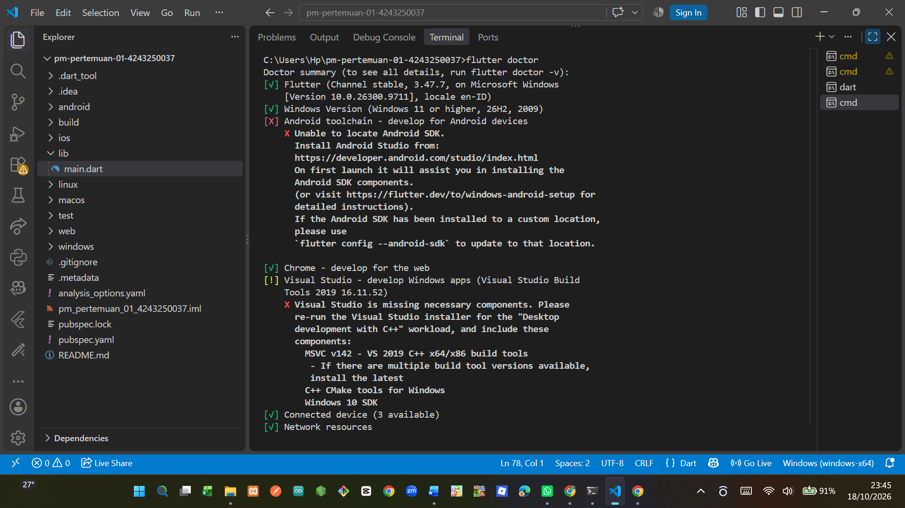

# Tugas Rutin 1 - Pemrograman Mobile

## Identitas Mahasiswa
- Nama: Lastri Putri Silaban
- NIM: 4243250037
- Kelas: PSIK-24C

## Deskripsi Proyek
Aplikasi Hello World dibuat menggunakan Flutter dan
bahasa pemrograman Dart. Aplikasi menampilkan nama,
NIM, kelas, ikon ponsel, dan kartu pesan.

## Teknologi yang Digunakan
- Flutter: 3.47.7
- Dart: 3.13.5
- Editor: Visual Studio Code
- Browser pengujian: Google Chrome

## Cara Menjalankan Aplikasi
1. Pastikan Flutter SDK sudah terpasang.
2. Buka folder proyek melalui terminal.
3. Jalankan perintah flutter pub get.
4. Jalankan perintah flutter run -d chrome.

## Screenshot Flutter Doctor

## Screenshot Aplikasi

## Kendala dan Solusi

### 1. Nama proyek tidak sesuai aturan Dart
Kendala: Nama proyek dengan tanda hubung ditolak
karena nama package Dart menggunakan format tertentu.

Solusi: Menggunakan nama package dengan huruf kecil
dan garis bawah, yaitu pm_pertemuan_01_4243250037.

### 2. Android SDK belum terpasang
Kendala: Flutter Doctor menunjukkan Android SDK
belum tersedia untuk pengembangan aplikasi Android.

Solusi: Aplikasi diuji melalui Google Chrome karena
Flutter dan Chrome sudah terdeteksi. Jika diperlukan
pengujian Android, Android SDK dapat dipasang kemudian.

## Pernyataan Penggunaan AI
Saya menggunakan ChatGPT sebagai alat bantu untuk
memahami instalasi Flutter, mempelajari struktur kode,
dan menyusun dokumentasi. Saya bertanggung jawab untuk
memeriksa, menguji, dan memahami kode yang digunakan.

## Riwayat Pengembangan
Riwayat perubahan proyek dapat dilihat pada commit
di repository GitHub.
